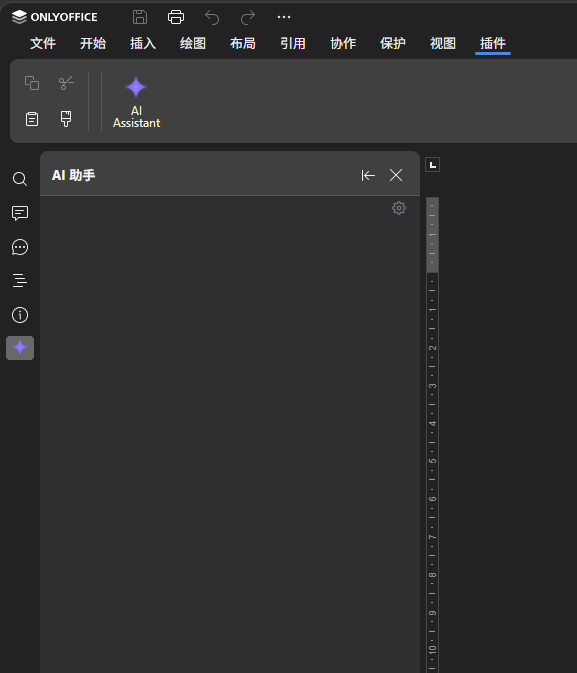
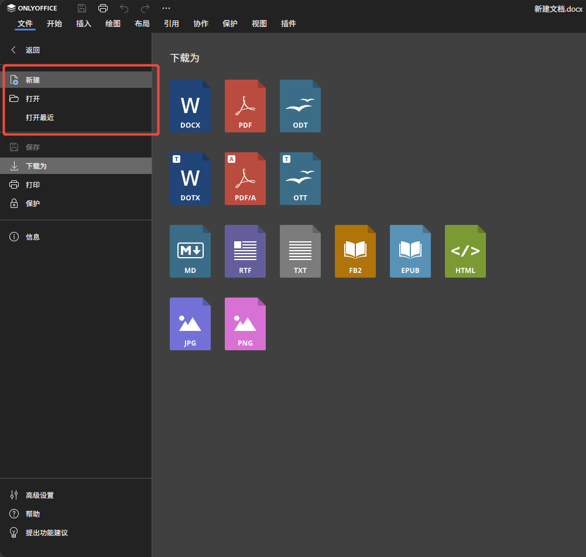

# OnlyOffice 极简在线编辑器

一体化 Docker 镜像，包含前端编辑器 + OnlyOffice Document Server，内置 AI 助手（直接改写文档）。

## ✨ 相比原生 OnlyOffice 改了什么

- **AI 助手侧边栏**：直连任意 OpenAI 兼容 API（DeepSeek/GLM 等），回复解析成指令**直接写入正在编辑的文档**（插入、替换、格式化）；点赞过的回复会记住，相似问题秒回；面板里可改 API 地址 / Key / 模型 / 提示词，即时生效
- **文件菜单补全**：解锁 DS 网页版隐藏的原生「打开...」（弹系统文件对话框选本地 docx/xlsx/pptx），「新建」一键生成空白文档
- **干净的访问地址**：本地文档用短链 `/?f=<id>` 打开，不暴露内部代理 URL；远程文档用 `/?url=<地址>`
- **单进程单端口**：前端 + AI 后端 + 插件全部收进 8090 一个端口，OnlyOffice(8089) 仅内部通信
- **极简界面**：移除 DS 自带的一堆插件，只留 AI 助手
- **一键打包**：`build.sh` 双平台——Docker 一体化镜像，或 Windows 下 Bun 编译成**单个 exe**（零运行时依赖）

| AI 助手直接改写文档 | 原生文件菜单「新建 / 打开」 |
| --- | --- |
|  |  |

## 🚀 快速部署（Docker 方式）

拉取项目后，**无需手动构建前端**——Dockerfile 采用多阶段构建，`docker build` 时会自动执行 `npm install` 和 `npm run build`。

```bash
# 构建镜像（前端构建自动完成）
docker build -t onlyoffice-editor .

# 启动容器
# 8090 = 前端，8089 = OnlyOffice API
docker run -d -p 8090:8090 -p 8089:80 --name onlyoffice onlyoffice-editor
```

## 📦 离线部署（已有镜像 tar 包）

服务器上没有源码、或不方便拉取 npm 依赖时，直接导入镜像：

```bash
# 导入镜像
docker load -i onlyoffice-editor.tar.gz

# 启动（同上）
docker run -d -p 8090:8090 -p 8089:80 --name onlyoffice onlyoffice-editor
```

## 🪟 Windows Server 部署（原生，免 Docker）

在开发机上执行 `./build.sh --windows`，产出 `frontend/dist-win/`（单文件 `ai-editor.exe` + 前端 dist + 部署说明）。

服务器上：

1. 安装 [OnlyOffice Docs](https://www.onlyoffice.com/download-docs.aspx)（Windows 版 Community Edition），端口选 **8089**
2. 把 `dist-win/` 整体复制到服务器任意位置（如 `D:\ai-editor`）
3. 复制 `.env.example` 为 `.env`，填入 `DEEPSEEK_API_KEY`（也可不填，启动后在 AI 面板齿轮设置里填，立即生效）
4. 双击 `ai-editor.exe`，看到 `listening on :8090` 即成功
5. 浏览器访问 `http://服务器IP:8090/?url=<文档地址>`

> `ai-editor.exe` 是 Bun 编译的零依赖单进程服务（前端 + AI 接口 + 插件全在 8090）；开机自启用 NSSM 或 WinSW 注册成 Windows 服务；`data/` 目录存运行时配置，可整体备份。

## 💻 本地开发（不用 Docker 跑前端）

只需 Docker 跑 OnlyOffice，前端用 Vite 热更新调试：

```bash
# 1. 启动 OnlyOffice（映射到 8089）
docker run -d -p 8089:80 --name onlyoffice-dev onlyoffice/documentserver

# 2. 启动前端开发服务器（端口 8090）
cd frontend
npm install
npm run dev
```

## 📝 使用方法

```
http://localhost:8090?url=在线文档地址
```

**示例：**
```
http://localhost:8090?url=https://filesamples.com/samples/document/docx/sample2.docx
```

也可以在编辑器菜单里直接 **文件 → 新建**（生成空白文档）、**文件 → 打开**（选择本地文件）。

## 📊 端口说明

| 端口 | 用途 | 说明 |
|------|------|------|
| **8090** | 前端页面 | 用户访问入口 |
| **8089** | OnlyOffice API | 内部接口（前端自动调用） |

## 📦 支持格式

- Word: `.docx`, `.doc`
- Excel: `.xlsx`, `.xls`
- PowerPoint: `.pptx`, `.ppt`

## ☕ 支持一下

如果这个项目对你有帮助，欢迎请作者喝杯咖啡～

| 微信 | 支付宝 |
| --- | --- |
|  |  |

## 📄 License

MIT
